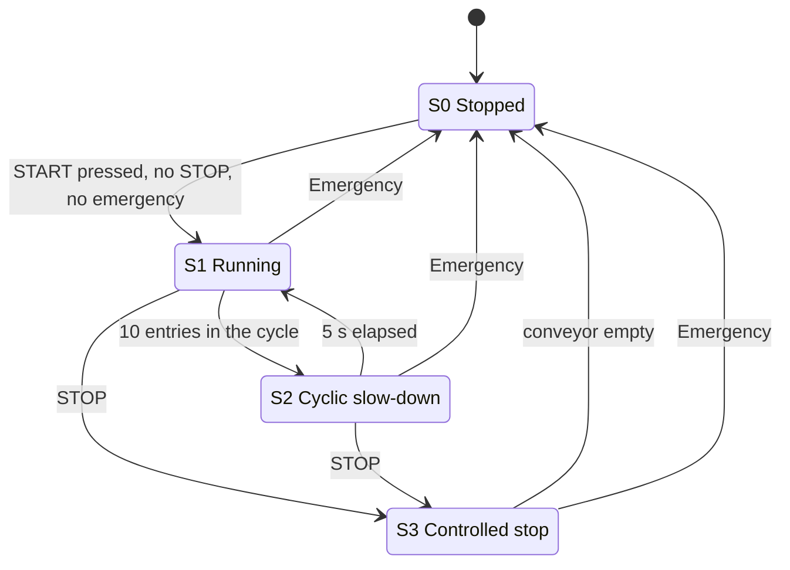

# Conveyor Control with an Omron MX2 Drive (EzSQ)

An automatic material-transport system controlled **exclusively by an Omron MX2 variable frequency drive (VFD)**, with no PLC. The control logic runs inside the drive itself, programmed in **EzSQ** (the BASIC-style language built into the MX2) with **CX-Drive**, as a **four-state state machine**.

The drive powers a three-phase induction motor driving a conveyor. Push buttons simulate the entry and exit sensors and the operator commands, and two LEDs signal the state of the system. The program offers:

- **Soft start and soft stop** (ramp time set to 5 s)
- **Four selectable speeds** (10, 20, 30 and 40 Hz)
- **Counting of pieces** entering and leaving the conveyor
- **Automatic slow-down:** every 10 pieces that enter, the speed drops to half for 5 s
- **Controlled stop:** after STOP the conveyor keeps running at minimum speed until the last piece leaves, then stops smoothly
- **Emergency stop** and interlocks between the buttons

> Project developed for the course **Electric Machines**, BSc in **Electrical and Computer Engineering**, **Instituto Politécnico do Cávado e Ave (IPCA)**, **2st year**.

---

## Repository structure

```
.
├── [CX-Drive project].sdd      # drive program and parameters
├── [wiring diagram].drawio     # editable wiring diagram
├── [wiring diagram].png        # wiring diagram image
├── images/                     # CX-Drive monitoring traces
└── README.md
```

---

## Inputs, outputs and variables

### Inputs

| Input | Function |
|---|---|
| `X(00)` | Entry sensor (a piece enters the conveyor) |
| `X(01)` | Exit sensor (a piece leaves the conveyor) |
| `X(02)` | Speed change |
| `X(03)` | START |
| `X(04)` | STOP (active when the input reads `0`, so it is wired as a normally-closed contact) |
| `X(05)` | Emergency (active when the input reads `1`) |

### Outputs

| Output | Function |
|---|---|
| `Y(00)` | Green LED: conveyor running |
| `Y(01)` | Red LED: conveyor stopped |

### Internal variables

| Variable | Function |
|---|---|
| `U(12)` | Total entries |
| `U(13)` | Total exits |
| `U(19)` | Entries since the last slow-down |
| `U(20)` | Exits since the last slow-down |
| `U(14)` | Running frequency, in units of 0.01 Hz |
| `U(16)` | Speed ID (0 to 3) |
| `U(17)` | Flag: the 5 s timer has been started |
| `U(27)` | Flag: halve the speed |
| `U(18)` | Pieces on the conveyor (entries minus exits) |
| `TD(0)` | 5 s timer |

---

## State machine



### S0 – Stopped (initial and final state)

- Red LED on, green LED off.
- All counters and flags are reset.
- If the motor is still running, it is stopped immediately, with no soft ramp (deceleration time set to 0).
- Each press of the speed button selects the next speed level, cycling through 10, 20, 30, 40 Hz and back to 10 Hz. The frequency is applied to the drive right away. The speed can only be changed in this state.
- Pressing **START** moves to S1, unless STOP or the emergency button is active. Otherwise it stays in S0.

| Speed ID | `U(14)` | Frequency |
|---|---|---|
| 0 | 1000 | 10 Hz |
| 1 | 2000 | 20 Hz |
| 2 | 3000 | 30 Hz |
| 3 | 4000 | 40 Hz |

### S1 – Normal operation

- Emergency sends the system back to S0, and STOP sends it to S3.
- If the motor is off, it starts with a **soft acceleration** (`ACCEL` = 5 s). The green LED turns on and the red one turns off.
- Each press of the entry sensor increments the total and the cycle entry counters, and each press of the exit sensor increments the exit counters. The program waits for each button to be released before counting again.
- When the cycle entry counter reaches **10**, the program goes to S2.

### S2 – Cyclic slow-down

- Emergency goes to S0 and STOP goes to S3.
- Entries and exits keep being counted.
- On entering the state, the 5 s timer is started and the frequency is **halved**.
- When the timer ends, the cycle counters are reset, the previous frequency is restored and the program returns to S1.

### S3 – Controlled stop

Triggered by the STOP button (emergency still takes priority and goes to S0).

- Entries and exits keep being counted, and the pieces on the conveyor are computed as `U(18) = entries − exits`.
- If there are still pieces (`U(18) > 0`), the frequency drops to the **minimum (10 Hz)** and the state is kept, so the conveyor keeps transporting them.
- When the conveyor is **empty** (`U(18) = 0`), the green LED turns off, the red one turns on, the motor is stopped with a **soft deceleration** (`DECEL` = 5 s) and the program returns to S0.

---

## Wiring diagram

The drive is supplied through terminals `L1` and `N`, the motor is connected to `U/T1`, `V/T2` and `W/T3`, push buttons are wired to the drive's intelligent inputs, and the two LEDs to its intelligent outputs.


---

## Behaviour verified with CX-Drive

All the captures below come from the **monitoring tool of CX-Drive**, running on the drive. In every capture, `d001` (magenta) is the output frequency. In the first group of captures, the buttons `X(03)`, `X(04)` and `X(05)` are START, STOP and emergency. In the second group, `U(12)` to `U(20)` are the counters and variables of the program, and `d006.1` is the output `Y(00)`, the green LED.

### Speed selection

While stopped, each press of the speed button raises `U(14)` one level: 10, 20, 30 and 40 Hz (after 40 Hz it wraps back to 10 Hz).


### Soft start

After START, the output frequency rises smoothly from 0 to the selected speed (40 Hz here), and the green LED turns on.


### START and STOP

START ramps the motor up, and STOP brings it back down smoothly. Here STOP was pressed early, so the motor never reached the selected speed. STOP is active when its input reads `0`, which is why its trace drops when the button is pressed.


### Interlocks

START and STOP pressed **at the same time** do not start the motor:


With the **emergency button latched**, pressing START (twice here) does nothing:


### Emergency stop

With the motor running (10 Hz here), latching the emergency button stops it:


### Cyclic slow-down

The staircase on the left is the entry counters. After the **10th entry**, the frequency falls from 40 Hz to half (20 Hz), and when the 5 s timer ends it climbs back to 40 Hz.


### Controlled stop

When STOP is pressed with pieces still on the conveyor, the frequency drops to the minimum (10 Hz) and stays there while the pieces leave (the exit counter rises and the pieces on the conveyor fall). When the last piece leaves, the motor decelerates smoothly to 0.


---

## Using the project

Requires **CX-Drive** and an Omron **MX2** drive (3G3MX2).

1. Open the project in CX-Drive.
2. Transfer the program to the drive, and wire the inputs and outputs as in the diagram above.
3. Run it, and use the *Monitor* tool to follow the output frequency and the `X`, `Y` and `U` variables in real time.

---

## Notes and limitations

- Sensors are simulated with push buttons, so a real application would need debounce and filtering adapted to the actual sensors.
- The controlled stop assumes every exit was preceded by an entry. An exit without a matching entry (negative count) is not handled.
- Comments and variable descriptions in the program are in Portuguese.

---

## Author

**Ivo Azevedo**
